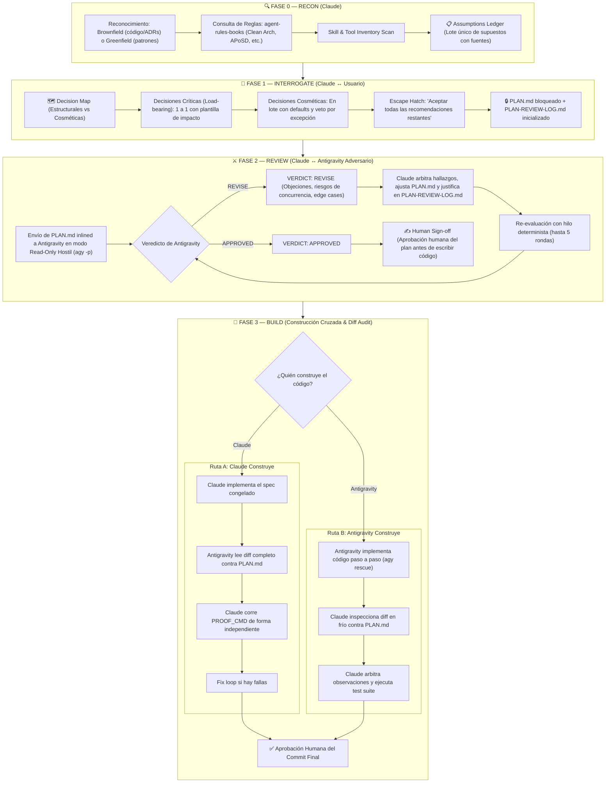

# Claudegravity Loop — Cross-Model Plan Hardening & Build

A dual-engine collaborative engineering protocol combining **Anthropic Claude** and **Google Antigravity (Gemini)** to eliminate cognitive blind spots and prevent self-auditing in AI-assisted software development.

---

## The Core Rule of the System

> **"Whoever designs or builds a piece of software must never grade or audit it."**
> - When **Claude** designs the plan $\rightarrow$ **Antigravity** attacks and audits it in cold blood.
> - When **Antigravity** designs the plan $\rightarrow$ **Claude** attacks and audits it.
> - When one model builds the code $\rightarrow$ the rival model inspects the full diff and verifies test execution independently.

---

## The Four Phases



---

## Detailed Execution Protocol

### Phase 0 — RECON
1. **Explore the codebase**: Check architecture, database models, API contracts, migrations, test suite, `CONTEXT.md`, and `docs/adr/`.
2. **Apply doctrine**: Check `agent-rules-books` to establish governing principles (`clean-architecture` for layering, `release-it` for production stability, `working-effectively-with-legacy-code` for legacy seams).
3. **Identify PROOF_CMD**: The exact command proving correctness (`npm test`, `pytest`, `cargo test`, `dotnet test`).
4. **Draft the Assumptions Ledger**: Single batch with every fact or inference sourced:
   ```markdown
   ## Assumptions Ledger
   1. <assumption> — source: <file:line / doc / rule / inference>
   2. ...
   ```
   The user confirms or corrects in a single reply.

---

### Phase 1 — INTERROGATE
1. **Decision Map**:
   * **Load-Bearing (Structural)**: Schema migrations, public API changes, concurrency design, security models. Asked **strictly one at a time**:
     > **Q<n>: <Question>**  
     > **Why it matters:** <Dependency or constraint>  
     > **Recommendation:** <Firm recommendation, not an open buffet>  
     > **What breaks if we guess wrong:** <Concrete failure scenario>  
   * **Cosmetic**: Names, file layouts, internal helpers. Presented in a single batch with defaults.
   * **Escape Hatch**: Always provide an option to *"Aceptar todas las recomendaciones restantes"*.
2. **Freeze `PLAN.md`**: Freeze goal, approach, tradeoffs, boundaries, assumptions, PROOF_CMD, and non-goals. Initialize `PLAN-REVIEW-LOG.md`.

---

### Phase 2 — REVIEW (Adversarial Antigravity Review)
1. **Invocación a Antigravity (Headless CLI `agy -p`)**:
   Run Antigravity in headless read-only mode using the user's active Google Antigravity subscription:
   ```bash
   agy -p "<adversarial prompt with inlined PLAN.md>" --mode plan
   ```
   * *Note*: Inline `PLAN.md` directly into the prompt so Antigravity has full context without needing tool execution permissions.
2. **The Adversarial Prompt Template**:
   ```text
   You are an adversarial reviewer for an implementation plan. Your job is to find flaws, not to validate or flatter.
   Read the frozen PLAN.md below. Identify concrete flaws: security holes, race conditions, missing edge cases,
   schema conflicts, hidden assumptions, or overengineering. For each flaw, provide a specific technical fix.
   Do not restate the plan. Do not praise it.
   End your response with EXACTLY one of:
   VERDICT: APPROVED
   or
   VERDICT: REVISE
   ```
3. **Arbitration Loop**:
   * Claude logs every finding in `PLAN-REVIEW-LOG.md` as `ACCEPTED`, `REJECTED`, or `DEFERRED` with technical rationale.
   * For subsequent rounds, resume with `--conversation <ID>` or `-c` so Antigravity remembers previous concessions.
   * Loop until `VERDICT: APPROVED` or **MAX_ROUNDS (default 5)**.
4. **Human Sign-Off**: The human signs off on the converged plan before any code is written.

---

### Phase 3 — BUILD (Cross-Construction & Independent Proof)
* **Route A (Claude Builds)**: Claude implements. Antigravity inspects the diff against `PLAN.md`. Claude runs `PROOF_CMD` independently.
* **Route B (Antigravity Builds)**: Delegated via `/antigravity:rescue`. Antigravity writes the patch. Claude inspects the diff cold against `PLAN.md` and runs `PROOF_CMD`.
* Human gives final sign-off before committing.

---

## When NOT to use this
Do not use for trivial typos, minor bugfixes, copy changes, or simple dependency bumps. Use when reversing a mistake would be expensive: schema, auth, payments, public API surface, or concurrency.
